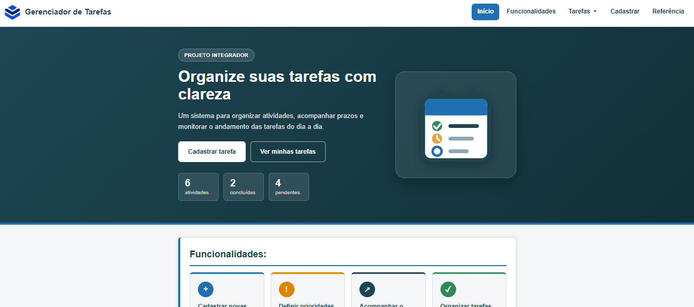
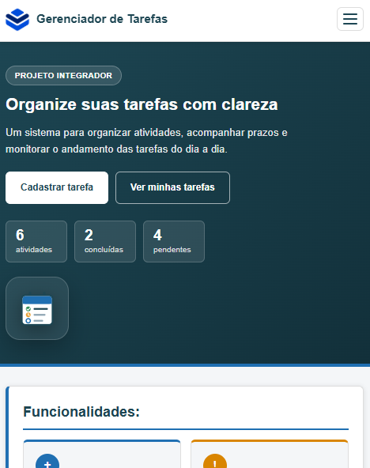

# Gerenciador de Tarefas

O Gerenciador de Tarefas é o Projeto Integrador da disciplina de Desenvolvimento Front-end para Web. Ele é voltado a estudantes e pessoas que querem organizar a rotina pessoal, reunindo estudo, trabalho, casa e saúde em um só lugar.

A aplicação permite cadastrar tarefas com categoria, prioridade, prazo e descrição, acompanhar o progresso de cada uma, buscar atividades pelo nome e ver um gráfico com a quantidade de tarefas por status. Também analisa os prazos e classifica cada tarefa em diferentes tipos.

## Tecnologias utilizadas

- HTML5 semântico.
- CSS3.
- JavaScript.

## Capturas de tela

### Desktop



### Celular



## Estrutura de pastas

```text
.
├── index.html
├── README.md
├── css/
│   ├── reset.css
│   └── style.css
├── js/
│   ├── logica.js
│   └── script.js
└── assets/
    ├── audio/
    │   ├── confirmacao-mp3.mp3
    │   └── confirmacao-ogg.ogg
    └── images/
        ├── gerenciador-logo.png
        ├── print-desktop.png
        └── print-celular.png
```

## Como executar

1. Clone o repositório: `git clone <link-do-repositorio>`.
2. Abra a pasta do projeto.
3. Abra o arquivo `index.html` no navegador, ou use a extensão Live Server do VS Code.

Não há dependências para instalar.

## Mapa dos requisitos

| Requisito | Onde foi atendido |
| --- | --- |
| Estrutura semântica | `index.html`: `nav`, `header`, `main`, `section`, `footer` e hierarquia de títulos (`h1` na navbar, `h2` nas seções) |
| Imagem com texto alternativo | `index.html`, logo na navbar com `alt`; também usada como favicon |
| Ícone em SVG | `index.html`, calendário no cabeçalho, com `<title>` e `aria-labelledby` |
| Gráfico em Canvas | `index.html`, `#grafico-tarefas`, desenhado por `js/script.js`, `desenharGrafico` |
| Mídia de áudio | `index.html`, `<audio id="som-confirmacao">` com fontes `.ogg` e `.mp3`, tocado em `js/script.js`, `tocarSomConfirmacao` |
| Tabela | `index.html`, seção "Minhas tarefas" (`thead`, `tbody` e `th scope="col"`), preenchida por `js/logica.js`, `atualizarTabela` |
| Formulário com label, fieldset e validação | `index.html`, seção "Cadastrar nova tarefa" (`label`, `fieldset`, `legend`, `required`, `select`, `datalist` e `input type="date"`) |
| Navegação interna e destaque da seção atual | `index.html`, `#menu-principal`, e `js/script.js`, `iniciarNavegacaoAtiva` |
| Navbar fixa e dropdown | `css/style.css`, `.navbar` (`position: sticky`) e `.submenu` |
| Flexbox | `css/style.css`, `.navbar`, `.navbar-links`, `.acoes-atividade` e `.apresentacao-acoes` |
| Variáveis CSS | `css/style.css`, bloco `:root` |
| Estados de foco e hover | `css/style.css`, regras `:focus-visible` e `:hover` |
| Seção em Grid com pseudo-classe estrutural | `css/style.css`, seção "Grade de funcionalidades": `.grade` e `.grade li:nth-child(1)` a `(4)` |
| Animação de hover com transform | `css/style.css`, `.grade li:hover` com `translateY` |
| Página responsiva | `css/style.css`, blocos `@media (max-width: 48rem)` |
| Lista de 5+ itens com 3+ propriedades | `js/script.js`, array `atividades`, e `js/logica.js`, array `tarefas` (6 itens cada) |
| Lógica: if / else if / else | `js/logica.js`, `analisarTarefas` (classificação por prazo) e `js/script.js`, `classificarProgresso` |
| Lógica: switch | `js/logica.js`, `analisarTarefas` (dica por categoria) e `js/script.js`, `tratarCliqueNaLista` |
| Lógica: for / for...of com acumulador | `js/logica.js`, `analisarTarefas` (soma de minutos, contagem de críticas, tarefa mais demorada) |
| Lógica: while | `js/logica.js`, `analisarTarefas` (registro de tarefas concluídas até digitar "sair") |
| Comentário de planejamento | `js/logica.js`, topo do arquivo (tema, entrada, processamento, saída e pseudocódigo) |
| Funções que processam e classificam | `js/script.js`, `calcularProgresso` (processa) e `classificarProgresso` (classifica) |
| const/let e coerção com Number() | `js/logica.js`, `lerLimiteUrgencia`, e `js/script.js`, `tratarEnvioFormulario` |
| Exemplo de escopo local | `js/logica.js`, variáveis `situacao` e `dica`, declaradas com `let` dentro do laço de `analisarTarefas` |
| map, filter e reduce | `js/script.js`: `avaliarAtividades` (map), `filtrarPorTexto` e `filtrarPendentes` (filter), `calcularResumo` (reduce) |
| createElement e textContent com classes CSS | `js/script.js`, `criarCartaoAtividade` e `atualizarResumo`; `js/logica.js`, `atualizarTabela` |
| Botão com aria-expanded e teclado | `js/script.js`, `definirMenu` e `alternarMenu` (menu hambúrguer, fecha também com Esc) |
| Delegação de eventos | `js/script.js`, `tratarCliqueNaLista`, ligada uma vez em `#lista-atividades` e válida para cartões criados depois |
| Busca com input | `js/script.js`, `campoBusca.addEventListener("input", desenhar)` em `iniciarPainel` |
| Resumo que se atualiza | `js/script.js`, `atualizarResumo`, dentro de `#resumo` com `aria-live="polite"` |
| Sem innerHTML com texto do usuário | Nenhum uso de `innerHTML` no projeto; os textos entram por `textContent` |
| Script com defer no final do body | `index.html`, últimas linhas do `<body>` |
| Arquivos sem nomes repetidos | `logica.js` carrega antes de `script.js`, e nenhum `const` ou função se repete entre eles |
| Acessibilidade | `alt` na logo, `label` em todos os campos, `aria-live` nas mensagens, `:focus-visible` e `<dialog>` com foco controlado |

## Autor

- Nome: Felipe Lima de Medeiros
- RGM: 49729691
- Curso: Análise e Desenvolvimento de Sistemas, UNIPÊ (João Pessoa)